# Class Activity 1 — System Calls in Practice

- **Student Name:** PUM BRUSMUNY
- **Student ID:** e20230959
- **Date:** 2026-10-14
- **Server:** `i4gic-os` (Ubuntu, kernel `7.0.0-38-generic`, user `gic-pum-brusmuny`)

---

## Warm-Up: Hello System Call

### Linux: `hello_syscall.c`
Prints a message with `write(1, ...)` instead of `printf()`. Source: [hello_syscall.c](hello_syscall.c)

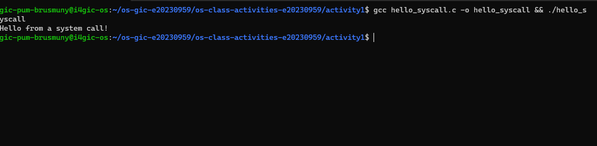

### Windows: `hello_winapi.c`
Prints a message with `GetStdHandle` and `WriteFile`. Compiled with MinGW `gcc` (MSYS2) and run on my Windows PC. Source: [hello_winapi.c](hello_winapi.c)

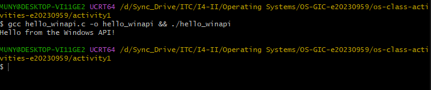

### File copy: `copyfilesyscall.c`
Copies `result.txt` to `copyresult.txt` with only `open`, `read`, `write` and `close`. Source: [copyfilesyscall.c](copyfilesyscall.c). Files: [result.txt](result.txt), [copyresult.txt](copyresult.txt).

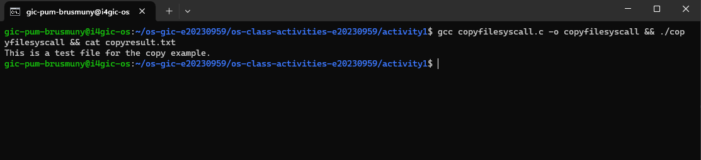

---

## Task 1: File Creator & Reader

Files in [task1/](task1/): `file_creator_lib.c`, `file_creator_sys.c`, `file_reader_lib.c`, `file_reader_sys.c`, `command_used_task1.txt`. Output files: `output.txt`, `out_lib.txt`, `out_sys.txt` (`diff` shows both versions give identical content).

### Part A — File Creator

**Implementation notes.** The library version uses `fopen`, `fprintf` and `fclose`. In the system call version I call `open()` with `O_WRONLY | O_CREAT | O_TRUNC` and mode `0644`, send the text with `write()` (using `strlen()` for the byte count), and close with `close()`. The confirmation message goes to file descriptor 1 with `write(1, ...)`. I also check that `open()` did not return a negative number.

```c
int fd = open("output.txt", O_WRONLY | O_CREAT | O_TRUNC, 0644);
if (fd < 0) { write(2, "open failed\n", 12); return 1; }
write(fd, text, strlen(text));
close(fd);
write(1, done, strlen(done));
```

**Version A — library** ([file_creator_lib.c](task1/file_creator_lib.c))
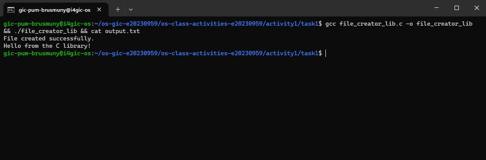

**Version B — POSIX** ([file_creator_sys.c](task1/file_creator_sys.c))
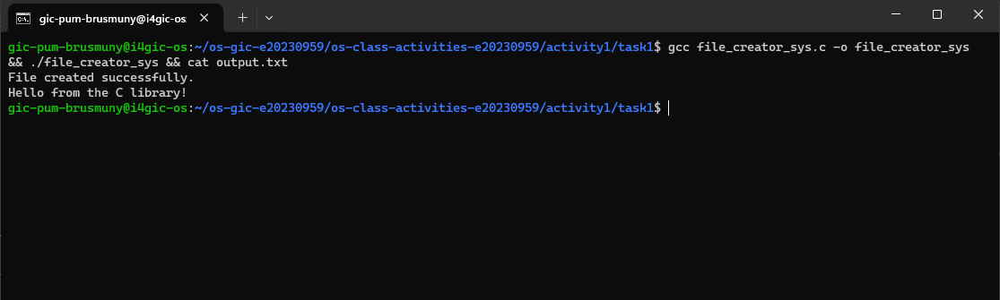

**Q1. What flags did you pass to `open()`? What does each flag mean?**
`O_WRONLY | O_CREAT | O_TRUNC`.
- `O_WRONLY`: open the file for writing only.
- `O_CREAT`: create the file if it does not exist.
- `O_TRUNC`: if the file already exists, cut its length to 0, so old content is discarded.

**Q2. What is `0644`? What does each digit represent?**
It is the permission mode, in octal, given to a newly created file. The leading `0` means octal. The three digits are owner, group and others. Each digit is the sum of read (4), write (2) and execute (1):
- `6` (owner) = read + write
- `4` (group) = read
- `4` (others) = read

The real permission is also masked by the process `umask`.

**Q3. What does `fopen("output.txt", "w")` do internally that you had to do manually with `open()`?**
`fopen` translates the mode `"w"` into the flags `O_WRONLY | O_CREAT | O_TRUNC` and picks the permission mode itself (`0666`, which the `umask` reduces to `0664`; visible in the `strace` output). It also allocates a `FILE` structure and an I/O buffer with `malloc`. With `open()` I had to give the flags and the mode myself and work with the raw file descriptor.

### Part B — File Reader & Display

**Implementation notes.** The library version reads line by line with `fgets` into a 256-byte buffer and prints with `printf`. The system call version opens the file with `open(..., O_RDONLY)` and uses a `while` loop around `read()` into a 256-byte buffer. Each chunk that was read is written to the terminal with `write(1, buf, n)`, using `n` (the value returned by `read`) as the byte count. The loop ends when `read()` returns 0.

```c
while ((n = read(fd, buf, sizeof buf)) > 0)
    write(1, buf, n);
```

**Version A — library** ([file_reader_lib.c](task1/file_reader_lib.c))
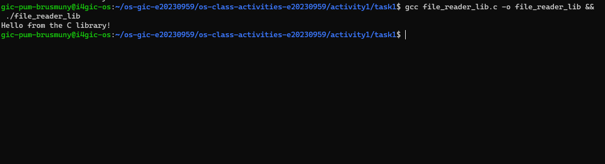

**Version B — POSIX** ([file_reader_sys.c](task1/file_reader_sys.c))
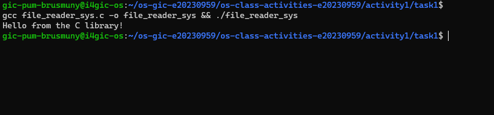

**Q1. What does `read()` return? How is this different from `fgets()`?**
`read()` returns the number of bytes actually read, `0` at end of file, and `-1` on error. It does not care about lines: it copies raw bytes into my buffer and does not add a `'\0'`. `fgets()` returns a pointer to the buffer (or `NULL` at EOF or error), reads at most one line, and adds the terminating `'\0'`.

**Q2. Why do you need a loop when using `read()`? When does it stop?**
One call to `read()` may return fewer bytes than the file holds, and my buffer is only 256 bytes, so I must keep reading until everything is consumed. The loop stops when `read()` returns `0` (end of file). In the traces, the second `read(3, "", 256) = 0` is that final call.

---

## Task 2: Directory Listing & File Info

Files in [task2/](task2/): `dir_list_lib.c`, `dir_list_sys.c`, `command_used_task2.txt`.

**Implementation notes.** Both versions keep `opendir`, `readdir` and `stat`. The library version prints with `printf`. In the system call version, `snprintf()` formats each line into a 512-byte buffer and returns its length, and `write(1, line, len)` prints it.

```c
int len = snprintf(line, sizeof line, "%-30s %10ld bytes\n", e->d_name, (long)st.st_size);
write(1, line, len);
```

**Version A — library** ([dir_list_lib.c](task2/dir_list_lib.c))
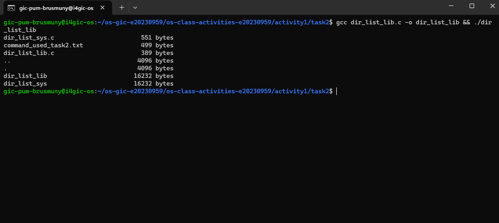

**Version B — syscall** ([dir_list_sys.c](task2/dir_list_sys.c))
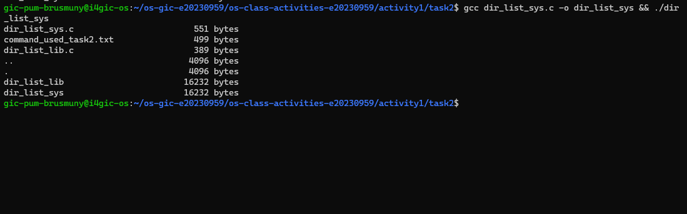

Both outputs match. I compared them with the results sorted and written outside the folder, because `readdir` order is not guaranteed and a result file inside the folder would list itself (see `command_used_task2.txt`).

**Q1. What struct does `readdir()` return? What fields does it contain?**
`struct dirent *`. On Linux its fields are `d_ino` (inode number), `d_off` (offset to the next entry), `d_reclen` (length of this record), `d_type` (file type, such as regular file or directory) and `d_name` (the file name).

**Q2. What information does `stat()` provide beyond file size?**
`struct stat` also contains the file type and permissions (`st_mode`), inode number (`st_ino`), device (`st_dev`), number of hard links (`st_nlink`), owner and group (`st_uid`, `st_gid`), block size and number of blocks (`st_blksize`, `st_blocks`), and the access, modification and status-change times (`st_atime`, `st_mtime`, `st_ctime`).

**Q3. Why can't you `write(1, some_number, ...)` directly? Why do you need `snprintf()` first?**
`write()` sends raw bytes. A number such as `4096` is stored in memory as a binary integer, so writing it would output unreadable bytes, not the characters `'4' '0' '9' '6'`. `snprintf()` converts the number to text and builds the whole formatted line in a buffer (and returns its length), and `write()` then sends that text.

---

## Optional Bonus: Windows API (`file_creator_win.c`)

Source: [file_creator_win.c](task1/file_creator_win.c)

**Implementation notes.** This is Task 1A written with the Windows API only. `CreateFileA()` with `GENERIC_WRITE` and `CREATE_ALWAYS` creates `output.txt` (or overwrites it, like `O_CREAT | O_TRUNC`) and returns a `HANDLE`, which I check against `INVALID_HANDLE_VALUE`. `WriteFile()` writes the text to the handle and `CloseHandle()` closes it. The confirmation goes to the console with `WriteFile()` on `GetStdHandle(STD_OUTPUT_HANDLE)`, the Windows equivalent of `write(1, ...)`. The text and confirmation are identical to Task 1A. Compiled with MinGW `gcc` (MSYS2) and run on my Windows PC.

| WinAPI | POSIX equivalent |
|---|---|
| `CreateFileA()` | `open()` |
| `WriteFile()` | `write()` |
| `CloseHandle()` | `close()` |
| `GetStdHandle()` | `write(1, ...)` target |

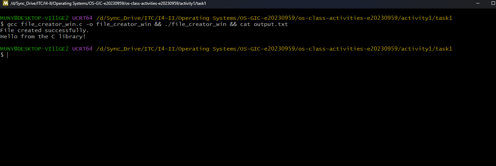

**Bonus Q1. Why does Windows use `HANDLE` instead of integer file descriptors?**
A `HANDLE` is an opaque reference to a kernel object. Windows uses the same type for files, processes, threads, events, mutexes, pipes and the console, so one mechanism (`CloseHandle`, `WaitForSingleObject`, security descriptors) works for all of them. A POSIX file descriptor is just a small integer (0, 1, 2, 3, ...) that indexes the process's file table and is mainly for files and file-like things. A handle carries more design: the kernel can attach access rights and security to it, and the program must treat it as a black box and never do arithmetic on it.

**Bonus Q2. What is the Windows equivalent of POSIX `fork()`? Why is it different?**
The closest equivalent is `CreateProcess()`. `fork()` clones the calling process (same memory and open files) and then the child usually calls `exec()` to load a new program. `CreateProcess()` does both in one step: it creates a new process directly from an executable file, with its own fresh address space, and the caller passes the program name, arguments, and settings. Windows has no `fork()` because its process model was designed around creating a new process from a program image, not copying an existing one. That is also cheaper than copying a whole process only to replace it.

**Bonus Q3. Can you use POSIX calls on Windows?**
Not natively: Windows does not provide `fork()`, `open()` or file descriptors as its own system interface (some C runtime functions such as `_open` exist, but they are a thin layer over the Windows API). You can get POSIX behavior through a compatibility layer:
- **WSL (Windows Subsystem for Linux):** runs a real Linux environment, so Linux programs and POSIX calls work as they do on a Linux machine.
- **Cygwin:** provides a POSIX API library (`cygwin1.dll`) so that POSIX programs can be compiled for Windows and run there.

---

## Task 3: strace Analysis

Files in [task3_strace/](task3_strace/): `strace_lib_task1.txt`, `strace_sys_task1.txt`, `strace_lib_reader.txt`, `strace_sys_reader.txt`, `strace_summary_lib.txt`, `strace_summary_sys.txt`, `command_used_strace.txt`. Extra: the full traces `lib_trace.txt` and `sys_trace.txt`.

### Observations

- The two file-creator traces have the same `openat`, `write`, `close`, `write` sequence for my own code. The difference is in the startup and the library setup around it.
- I was surprised that `fprintf` did not call `write` immediately. The text waited in a buffer until `fclose`.
- The library version made 4 more system calls than the syscall version (38 against 34): 2 extra `brk` and 2 extra `fstat`.
- `fopen` asked for mode `0666`; I asked for `0644` in the syscall version.
- The `mmap`, `mprotect`, `openat(libc.so.6)` calls at the start appear in **both** versions. That is the dynamic loader loading `libc`, not my code.

### strace — file creator

**Library version**
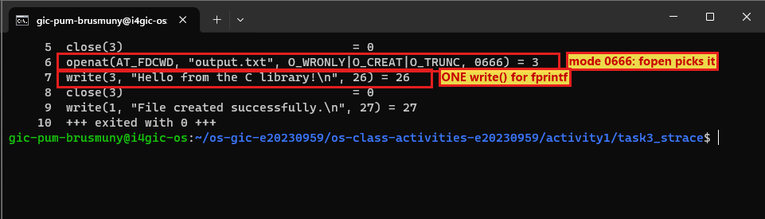

**Syscall version**
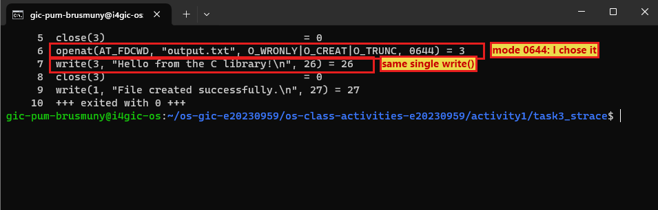

**Library version, full trace (extra `brk` and `fstat` calls highlighted)**
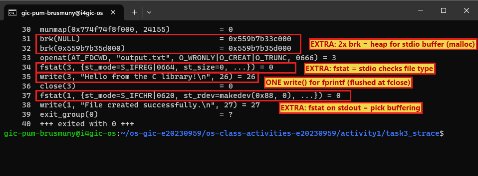

### strace — file reader

**Library version**
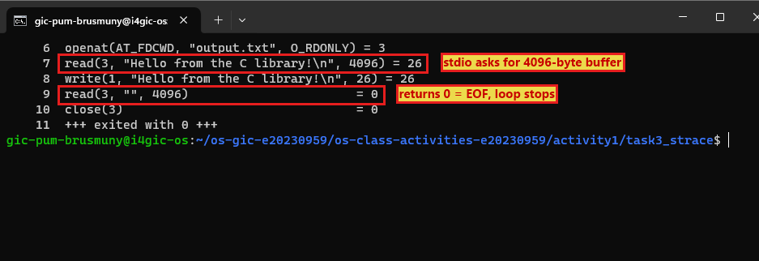

**Syscall version**
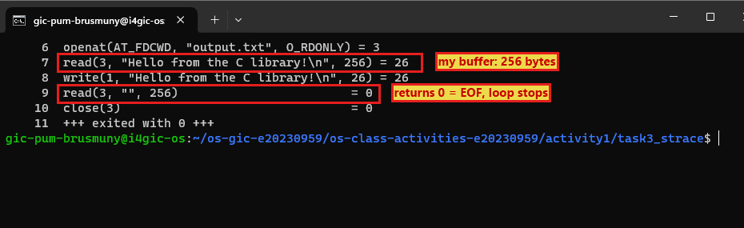

### `strace -c` summary comparison

**Library version**
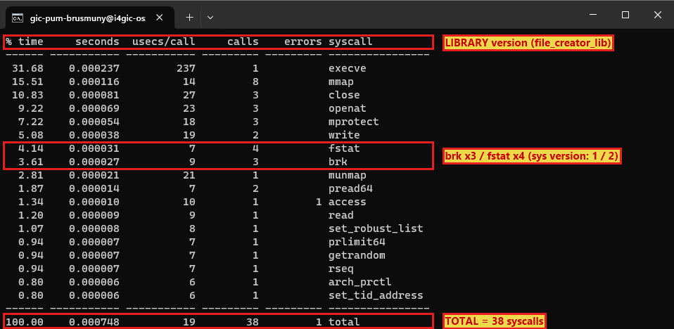

**Syscall version**
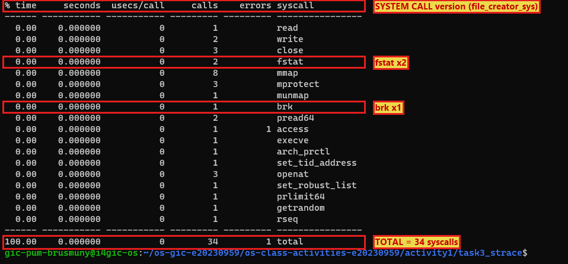

### Questions

**Q1. How many system calls does the library version of Task 1 make compared to the system call version?**
From `strace -c`: the library version makes **38** system calls and the system call version makes **34**. The library version makes 4 more.

**Q2. What extra system calls do you see in the library version that are not in the system call version? What do they do?**
- **`brk` (3 against 1):** two extra calls, `brk(NULL)` and `brk(0x559b7b35d000)`. They grow the heap, because `fopen` calls `malloc` to allocate the `FILE` structure and its I/O buffer.
- **`fstat` (4 against 2):** two extra calls: `fstat(3, ...)` on the output file and `fstat(1, ...)` on standard output. `stdio` uses them to learn the file type and block size, so it can choose a buffer size and decide between line buffering (terminal) and full buffering (file).

**Q3. When the library version calls `fprintf()`, how many actual `write()` system calls does `strace` show? Does it match what you expected?**
One: `write(3, "Hello from the C library!\n", 26) = 26`, just before `close(3)`. I expected `fprintf()` to call `write()` right away, but it does not. `stdio` stores the text in a user-space buffer and only flushes it when the file is closed (`fclose`), which then makes the single `write`. For one short line the count equals the syscall version, but with many small `fprintf` calls the library would batch them into far fewer `write()` calls, while raw `write()` makes one system call each time. The reader shows the same idea: `fgets` made `stdio` call `read(3, ..., 4096)` for a whole 4096-byte buffer, while my version used the 256-byte buffer I chose myself.

**Q4. What is the real difference between a library function and a system call?**
A system call (`open`, `read`, `write`, `close`) is the actual entry point into the kernel: the CPU switches to kernel mode and the OS does the work. A library function (`fopen`, `fprintf`, `fgets`) is ordinary user-space code inside `libc`. It can add buffering, formatting and `malloc`, and then calls system calls underneath. The trace proves it: `fprintf` shows up as a `write` system call. Library functions are more convenient and portable, but they add extra calls and hide when the real system call happens.

---

## Task 4: Exploring OS Structure

### System information (`uname`, `/proc/cpuinfo`, `/proc/meminfo`, `/proc/version`, `/proc/uptime`)
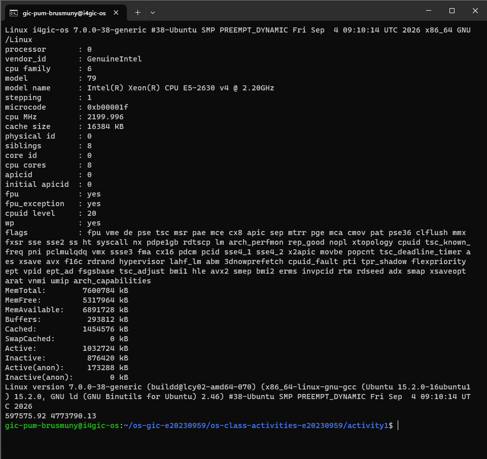

### Process information (`/proc/self/status`, `/proc/self/maps`, `/proc/self/cmdline`, `ps aux`)
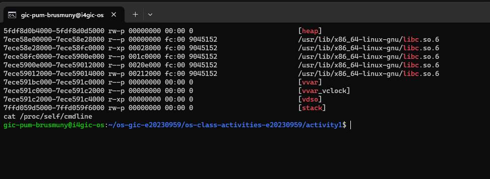

### Kernel modules (`lsmod` and `modinfo`)
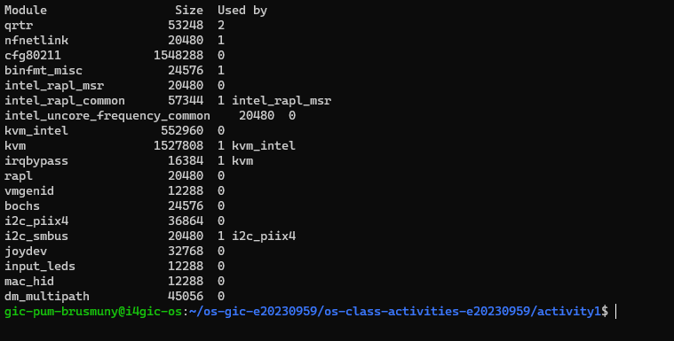

### OS layers diagram (real data from this server)
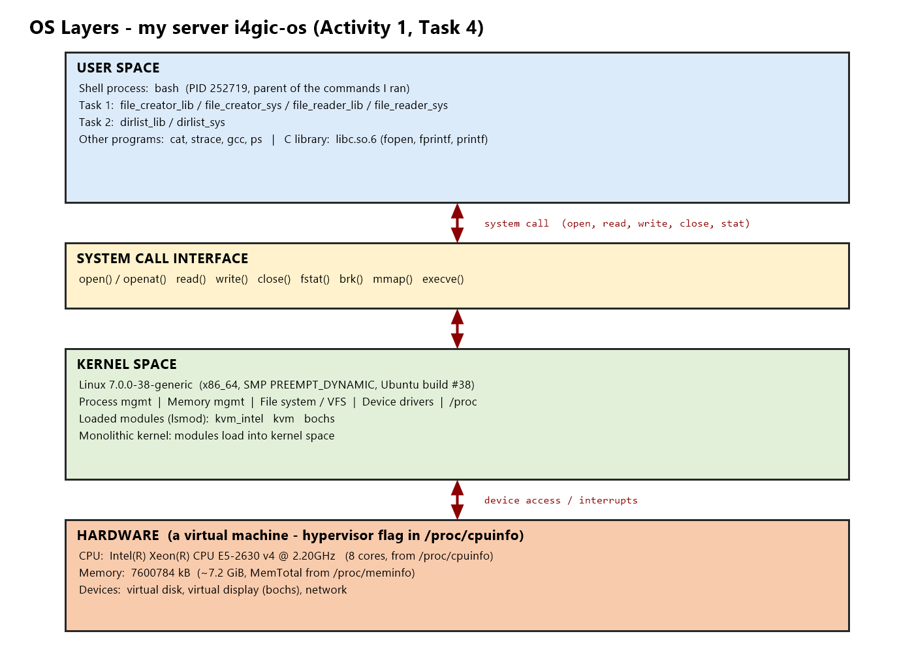

The server is a virtual machine: the `hypervisor` flag appears in `/proc/cpuinfo` and the `bochs` virtual display module is loaded.

### Questions

**Q1. What is `/proc`? Is it a real filesystem on disk? Where does its content come from?**
`/proc` is a virtual (pseudo) filesystem. It is not stored on disk. The kernel generates its files on demand from live kernel data structures in memory, so reading `/proc/meminfo` or `/proc/uptime` gives the current state at that moment. Files such as `/proc/self` show information about the process that reads them.

**Q2. What is the difference between a monolithic kernel and a microkernel? Based on `lsmod`, which type does Linux use?**
A monolithic kernel runs almost all OS services (process and memory management, file systems, device drivers, networking) together in kernel space as one big program. A microkernel keeps only a minimal core (scheduling, IPC, basic memory handling) in kernel space and runs the rest, such as drivers and file systems, as separate user-space servers. Linux is **monolithic but modular**: `lsmod` lists modules such as `kvm`, `kvm_intel` and `bochs` that can be loaded and unloaded at runtime, but they run inside kernel space with full kernel privileges, not as separate user-space servers.

**Q3. Look at `cat /proc/self/maps`. What different memory regions do you see?**
- The program image (`/usr/lib/cargo/bin/coreutils/cat`): `r--p` (read-only data), `r-xp` (executable code) and `rw-p` (writable data).
- `[heap]`: memory for dynamic allocation (`malloc`).
- Shared libraries: `libc.so.6`, `libm.so.6`, `libpcre2-8.so.0.14.0`, each with a read-only, an executable and a writable part.
- Anonymous `rw-p` regions (no file name) used for buffers and library data.
- `[stack]`: the process stack.
- `[vdso]`, `[vvar]`: kernel-provided pages that let a program read things like the time without a full system call.

**Q4. What does the kernel version string (from `uname -a`) tell you? Break down each part.**
`Linux i4gic-os 7.0.0-38-generic #38-Ubuntu SMP PREEMPT_DYNAMIC Fri Sep 4 09:10:14 UTC 2026 x86_64 GNU/Linux`
- `Linux`: kernel name.
- `i4gic-os`: hostname of the machine.
- `7.0.0-38-generic`: kernel version 7.0.0, Ubuntu package build 38, `generic` kernel flavour.
- `#38-Ubuntu`: build number and the distribution that built it.
- `SMP`: supports multiple processors/cores.
- `PREEMPT_DYNAMIC`: the preemption model, which can be changed at boot.
- `Fri Sep 4 09:10:14 UTC 2026`: when the kernel was built.
- `x86_64`: 64-bit x86 architecture.
- `GNU/Linux`: the operating system.

**Q5. How does `/proc` demonstrate that the OS acts as an intermediary between user programs and hardware?**
A user program cannot read hardware details such as the CPU model or memory size directly. It asks the kernel with ordinary system calls (`open`, `read`) on files like `/proc/cpuinfo` and `/proc/meminfo`. The kernel collects the data from the hardware (here the Intel Xeon E5-2630 v4 and 7600784 kB of RAM) and hands it to the program as if it were a text file. The program never touches the hardware itself, so the kernel sits in the middle, controlling and simplifying access.

---

## Reflection

Before this activity I used `fopen` and `printf` without thinking about what happens underneath. Tracing both versions with `strace` showed me that every library call ends in a system call, and that the library adds work of its own (heap allocation, `fstat` checks and buffering). The most surprising result was that `fprintf` does not call `write()` until the file is closed. Writing the `open`/`read`/`write` versions by hand also taught me why a `read()` loop and `snprintf()` are needed. Looking at `/proc` made the idea of the kernel as an intermediary concrete: even reading the CPU model goes through a system call.
