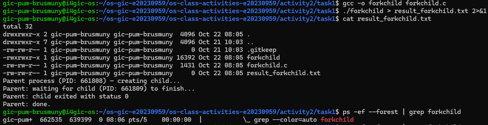
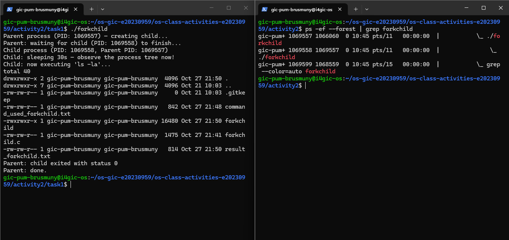
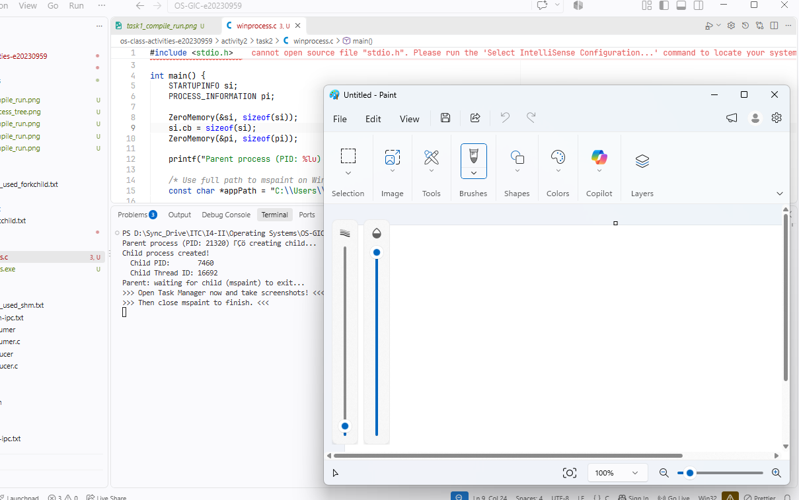
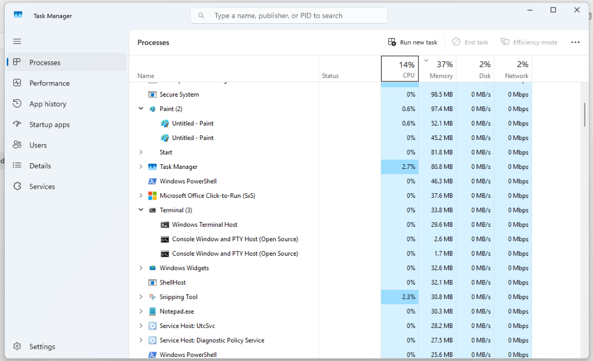
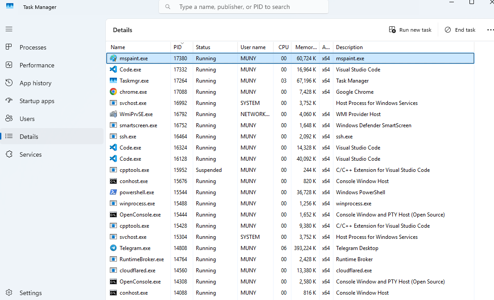
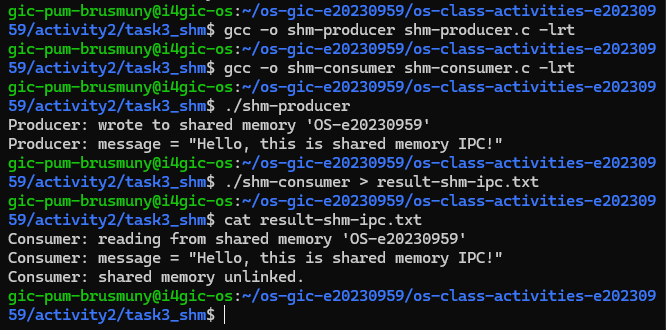
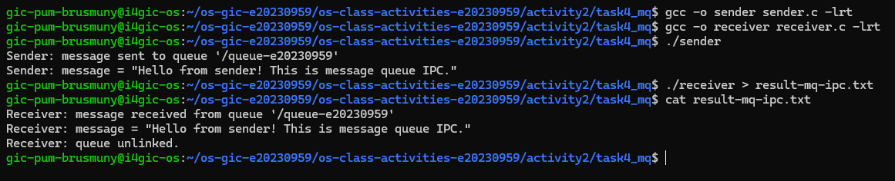

# Class Activity 2 — Processes & Inter-Process Communication

- **Student Name:** PUM BRUSMUNY
- **Student ID:** e20230959
- **Date:** 2026-10-28
- **Server:** `i4gic-os` (Ubuntu, user `gic-pum-brusmuny`)

---

## Task 1: Process Creation on Linux (fork + exec)

### Compilation & Execution

Screenshot of compiling and running `forkchild.c`:



### Process Tree

Screenshot of the parent-child process tree (using `ps --forest`):



### Output

```text
Parent process (PID: 1023198) — creating child...
Child process (PID: 1023199, Parent PID: 1023198)
Child: sleeping 30s — observe the process tree now!
total 40
drwxrwxr-x 2 gic-pum-brusmuny gic-pum-brusmuny  4096 Oct 27 21:50 .
drwxrwxr-x 7 gic-pum-brusmuny gic-pum-brusmuny  4096 Oct 21 10:03 ..
-rw-rw-r-- 1 gic-pum-brusmuny gic-pum-brusmuny     0 Oct 21 10:03 .gitkeep
-rw-rw-r-- 1 gic-pum-brusmuny gic-pum-brusmuny   842 Oct 27 21:48 command_used_forkchild.txt
-rwxrwxr-x 1 gic-pum-brusmuny gic-pum-brusmuny 16480 Oct 27 21:50 forkchild
-rw-rw-r-- 1 gic-pum-brusmuny gic-pum-brusmuny  1475 Oct 27 21:41 forkchild.c
-rw-rw-r-- 1 gic-pum-brusmuny gic-pum-brusmuny   156 Oct 27 21:50 result_forkchild.txt
Parent: waiting for child (PID: 1023199) to finish...
Parent: child exited with status 0
Parent: done.
```

### Questions

1. **What does `fork()` return to the parent? What does it return to the child?**

   > - **To the parent:** `fork()` returns the PID of the newly created child process (a positive integer, e.g., `1069558`). If `fork()` fails, it returns `-1`.
   > - **To the child:** `fork()` returns `0`.

2. **What happens if you remove the `waitpid()` call? Why might the output look different?**

   > If `waitpid()` is removed:
   > 1. The parent does not wait for the child process to complete. Both execute concurrently.
   > 2. The parent will print `"Parent: done."` and terminate immediately while the child is still sleeping for 30 seconds. The terminal prompt will return before the child finishes, and the child's `ls -la` output will later print over the shell prompt.
   > 3. If the parent terminates first, the child becomes an **orphan process** and is adopted by the system init process (`systemd` / PID 1).

3. **What does `execlp()` do? Why don't we see "execlp failed" when it succeeds?**

   > `execlp()` replaces the current process image (code, data, heap, and stack) with a new program (`ls -la`), searching for the binary in directories listed in `PATH`.
   > When `execlp()` succeeds, the original program instructions no longer exist in memory — the process is now executing `ls`. Therefore, the lines following `execlp()` are never reached unless `execlp()` encounters an error.

4. **Draw the process tree for your program (parent → child). Include PIDs from your output.**

   > From the process tree run in `task1_process_tree.png`:
   > ```text
   > bash (PID: 1066060)
   >   └── ./forkchild (PID: 1069557) [Parent]
   >         └── ./forkchild (PID: 1069558) [Child]  --> executes 'ls -la'
   > ```

5. **Which command did you use to view the process tree (`ps --forest`, `pstree`, or `htop`)? What information does each column show?**

   > I used `ps -ef --forest | grep forkchild`.
   > The columns show:
   > - `UID`: The username owning the process (`gic-pum-brusmuny`).
   > - `PID`: The unique process ID (`1069557`, `1069558`).
   > - `PPID`: The Parent Process ID (`1066060` for parent, `1069557` for child, matching the parent's PID).
   > - `C`: CPU utilization percentage (`0`).
   > - `STIME`: Process start time (`10:45`).
   > - `TTY`: Terminal session where the command runs (`pts/11`).
   > - `TIME`: Cumulative CPU execution time (`00:00:00`).
   > - `CMD`: The executable name with visual tree indentation (`\_ ./forkchild`).

---

## Task 2: Process Creation on Windows

### Compilation & Execution

Screenshot of compiling and running `winprocess.c`:



### Task Manager Screenshots

Screenshot showing process tree in the **Processes** tab (mspaint under user apps):



Screenshot showing PID and Parent PID in the **Details** tab:



### Questions

1. **What is the key difference between how Linux creates a process (`fork` + `exec`) and how Windows does it (`CreateProcess`)?**

   > - **Linux:** Uses a two-step model. `fork()` creates an exact clone of the current process address space, and then `exec()` replaces the memory image with a new executable program.
   > - **Windows:** Uses a single-step model via `CreateProcess()`. It directly creates a new process and loads the specified executable into memory in one API call. Windows does not have an exact equivalent of `fork()`.

2. **What does `WaitForSingleObject()` do? What is its Linux equivalent?**

   > `WaitForSingleObject()` blocks the calling parent thread until the specified object handle (the child process handle `pi.hProcess`) enters the signaled state (meaning the child process has terminated), or until the timeout expires.
   > Its Linux equivalent is `wait()` or `waitpid()`.

3. **Why do we need to call `CloseHandle()` at the end? What happens if we don't?**

   > `CreateProcess()` opens kernel handles to the newly created process (`pi.hProcess`) and its primary thread (`pi.hThread`). Calling `CloseHandle()` decrements their kernel reference counts.
   > If we do not call `CloseHandle()`, a handle resource leak occurs: the operating system cannot completely free the process kernel objects from memory even after the child process has exited.

4. **In Task Manager, what was the PID of your parent program and the PID of mspaint? Do they match your program's output?**

   > Yes, they match:
   > - In the compilation and run screenshot ([`task2_compile_run.png`](screenshots/task2_compile_run.png)):
   >   - Parent PID (`winprocess.exe`): `21320`
   >   - Child PID (`mspaint.exe`): `7460`
   > - In the Task Manager Details screenshot ([`task2_taskmanager_details.png`](screenshots/task2_taskmanager_details.png)):
   >   - Parent (`winprocess.exe`): PID `15488`
   >   - Child (`mspaint.exe`): PID `17380`
   > In each run, the PIDs displayed by the program output directly match the PIDs visible in Task Manager.

5. **Compare the Processes tab (tree view) and the Details tab (PID/PPID columns). Which view makes it easier to understand the parent-child relationship? Why?**

   > The **Details tab** makes it much clearer to verify the parent-child relationship.
   > - In Windows 11, the **Processes tab** groups packaged and GUI apps under top-level application categories (such as "Apps" or "Background processes") rather than displaying a strict process hierarchy tree under the console terminal.
   > - The **Details tab** provides explicit, unambiguous numerical columns for both **PID** and **Parent PID (PPID)**, making it easy to confirm that `mspaint.exe`'s Parent PID directly matches `winprocess.exe`'s PID.

---

## Task 3: Shared Memory IPC

### Compilation & Execution

Screenshot of compiling and running `shm-producer` and `shm-consumer`:



### Output

```text
Consumer: reading from shared memory 'OS-e20230959'
Consumer: message = "Hello, this is shared memory IPC!"
Consumer: shared memory unlinked.
```

### Questions

1. **What does `shm_open()` do? How is it different from `open()`?**

   > `shm_open()` creates or opens a POSIX shared memory object in virtual memory (`/dev/shm` in Linux) and returns a file descriptor.
   > Unlike standard `open()` which opens regular files stored persistently on the disk filesystem, `shm_open()` operates entirely in RAM (tmpfs), making data transfers fast without incurring disk I/O overhead.

2. **What does `mmap()` do? Why is shared memory faster than other IPC methods?**

   > `mmap()` maps the shared memory object referenced by the file descriptor directly into the calling process's virtual address space, returning a direct memory pointer (`void *`).
   > Shared memory is the fastest IPC mechanism because processes communicate by reading and writing directly to physical RAM. Once the mapping is established, no kernel system calls (no `read()` or `write()`) and no memory copies between user space and kernel space are required.

3. **Why must the shared memory name match between producer and consumer?**

   > The shared memory name (`"OS-e20230959"`) serves as the unique global identifier for the shared memory segment in the operating system. Both processes must use the exact same name so the consumer maps into the exact memory segment created by the producer.

4. **What does `shm_unlink()` do? What would happen if the consumer didn't call it?**

   > `shm_unlink()` removes the shared memory object name from the system. The memory segment is released once all processes close and unmap it.
   > If `shm_unlink()` is never called, the shared memory segment persists in `/dev/shm` indefinitely until the server is rebooted or it is manually deleted, causing a resource leak.

5. **If the consumer runs before the producer, what happens? Try it and describe the error.**

   > The consumer opens the shared memory object with `O_RDONLY` without the `O_CREAT` flag. If the producer has not created it yet, `shm_open()` returns `-1` with error `ENOENT` (`No such file or directory`). The consumer prints:
   > ```text
   > shm_open: No such file or directory
   > Hint: Did you run shm-producer first?
   > ```
   > and terminates with an error code.

---

## Task 4: Message Queue IPC

### Compilation & Execution

Screenshot of compiling and running `sender` and `receiver`:



### Output

```text
Receiver: message received from queue '/queue-e20230959'
Receiver: message = "Hello from sender! This is message queue IPC."
Receiver: queue unlinked.
```

### Questions

1. **How is a message queue different from shared memory? When would you use one over the other?**

   > - **Shared Memory:** Provides a continuous block of raw shared memory with no built-in synchronization or boundaries. Processes must coordinate reads/writes using mutexes or semaphores.
   > - **Message Queue:** A kernel-managed, synchronized FIFO queue that stores discrete, formatted messages with message boundaries and priority support.
   > - **When to use:** Use shared memory when transferring large volumes of data at high throughput. Use message queues when passing smaller discrete messages, tasks, or event notifications between processes without writing custom synchronization code.

2. **Why does the queue name in `common.h` need to start with `/`?**

   > POSIX standards mandate that POSIX message queue names must begin with a forward slash (`/`) and contain no further slashes (e.g., `"/queue-e20230959"`). This convention allows the kernel to identify and place the queue object within the POSIX IPC virtual filesystem (`/dev/mqueue`).

3. **What does `mq_unlink()` do? What happens if neither the sender nor receiver calls it?**

   > `mq_unlink()` removes the message queue name from the system and destroys the queue as soon as all active descriptors are closed.
   > If neither process calls `mq_unlink()`, the queue and any unread messages remain stored in kernel memory (`/dev/mqueue`). Subsequent runs may read stale messages or fail to initialize fresh attributes.

4. **What happens if you run the receiver before the sender?**

   > Since the receiver opens the queue with `O_RDONLY` without `O_CREAT`, if the sender has not yet run, `mq_open()` fails with error `ENOENT` (`No such file or directory`), prints an error hint, and exits. If the queue exists but contains no messages, `mq_receive()` blocks until a message is sent.

5. **Can multiple senders send to the same queue? Can multiple receivers read from the same queue?**

   > Yes. POSIX message queues support multiple senders and multiple receivers.
   > - Multiple senders can write messages concurrently into the same queue; messages are delivered in order of priority and arrival.
   > - Multiple receivers can read from the queue; each message is delivered to only one receiver (competing consumers pattern).

---

## Reflection

During this activity, I gained practical hands-on experience with process lifecycle management and inter-process communication on both Linux and Windows:

1. **Process Creation:** Comparing Linux's `fork()` + `exec()` with Windows's `CreateProcess()` was eye-opening. Linux separates creating a new process clone from replacing the program image, providing great flexibility for pipes and redirection. Windows combines both steps into `CreateProcess()`, providing strict explicit control via handles (`HANDLE`) and attributes.
2. **IPC Mechanisms:** Comparing Shared Memory and Message Queues made the engineering trade-offs very concrete. Shared memory is significantly faster because it operates directly in RAM without system call overhead, but requires careful coordination. Message queues handle synchronization and message boundaries automatically within the kernel, making them much simpler and safer for structured messaging.
