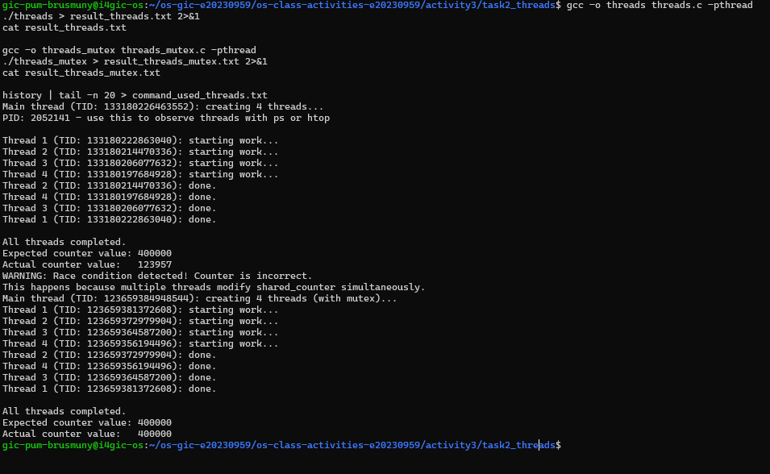
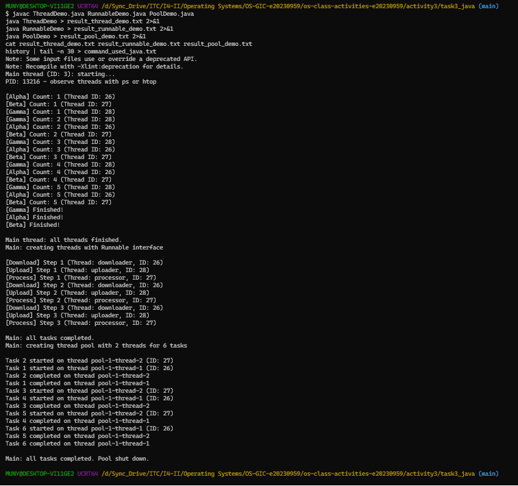
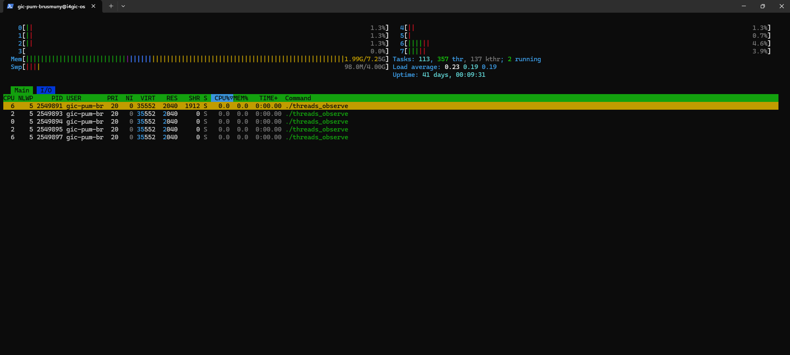
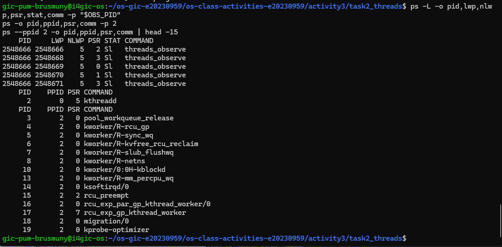
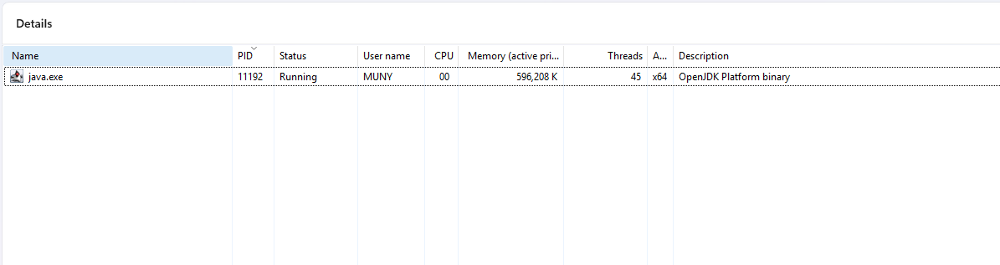

# Class Activity 3 — Socket Communication & Multithreading

- **Student Name:** PUM BRUSMUNY
- **Student ID:** e20230959
- **Date:** 2026-11-17
- **Server:** `i4gic-os` (Ubuntu, user `gic-pum-brusmuny`) + Windows (`DESKTOP-28AVG3P`)

---

## Task 1: TCP Socket Communication (C)

> **Note:** On the shared class server (`i4gic-os`), `PORT` was set to `20959` in both `server.c` and `client.c` to avoid port conflicts with other students using `8080`.

### Compilation & Execution


### Output (`result_socket.txt`)

```text
Server: socket created (fd=3)
Server: bound to port 20959
Server: listening... waiting for a client to connect.
Server: client connected!
Server: received from client: "Hello from client!"
Server: sent response: "Hello from server!"
Server: connection closed.
Client: socket created
Client: connecting to server on port 20959...
Client: connected!
Client: sent message: "Hello from client!"
Client: received from server: "Hello from server!"
Client: connection closed.
```

### Answers

1. **Role of `bind()` / Why client doesn't call it:**
   > `bind()` assigns a specific IP address (`INADDR_ANY`) and well-known port number (`20959`) to the server's socket so clients know where to reach it. The client does not need to call `bind()` because it only initiates an outgoing connection to the server's known IP and port; when `connect()` is called, the OS kernel automatically assigns an available ephemeral (temporary) source port to the client socket.

2. **What `accept()` returns:**
   > `accept()` returns a **new socket file descriptor** (`client_fd`) representing the active TCP connection with that specific client. The original `server_fd` remains a passive listening socket used solely to accept incoming connection requests, whereas `client_fd` is used for actual data exchange (`read()`/`recv()` and `send()`/`write()`) with the connected client.

3. **Starting client before server:**
   > If `./client` is started before `./server` is listening on port `20959`, there is no process bound to that port to complete the TCP 3-way handshake. The `connect()` call immediately fails, returns `-1` with `errno = ECONNREFUSED`, and `perror("connect")` prints:
   > ```text
   > Client: socket created
   > Client: connecting to server on port 20959...
   > connect: Connection refused
   > ```
   > and the client closes its socket and exits with `EXIT_FAILURE`.

4. **What `htons()` does:**
   > `htons()` ("host to network short") converts a 16-bit unsigned integer (such as `PORT = 20959`) from the machine's **host byte order** (little-endian on x86/x64) to **network byte order** (big-endian). Because different CPU architectures store multi-byte integers differently, network protocols standardize on big-endian so both sender and receiver interpret port numbers and addresses identically.

5. **Socket call sequence diagram:**
   > ```text
   > Server (Port 20959)                       Client
   > -------------------                       ------
   > socket()                                  socket()
   >   │                                         │
   > setsockopt(SO_REUSEADDR)                    │
   >   │                                         │
   > bind(INADDR_ANY, 20959)                     │
   >   │                                         │
   > listen()                                    │
   >   │                                         │
   > accept() ◄────── TCP 3-way handshake ───── connect(127.0.0.1:20959)
   >   │ (returns client_fd)                     │
   > read()   ◄────── "Hello from client!" ───── send()
   >   │                                         │
   > send()   ─────── "Hello from server!" ────► read()
   >   │                                         │
   > close(client_fd)                          close(sock_fd)
   > close(server_fd)
   > ```

---

## Task 2: POSIX Threads (C)

### Output — Without Mutex (Race Condition)



```text
Main thread (TID: 133180226463552): creating 4 threads...
PID: 2052141 - use this to observe threads with ps or htop

Thread 1 (TID: 133180222863040): starting work...
Thread 2 (TID: 133180214470336): starting work...
Thread 3 (TID: 133180206077632): starting work...
Thread 4 (TID: 133180197684928): starting work...
Thread 2 (TID: 133180214470336): done.
Thread 4 (TID: 133180197684928): done.
Thread 3 (TID: 133180206077632): done.
Thread 1 (TID: 133180222863040): done.

All threads completed.
Expected counter value: 400000
Actual counter value:   123957
WARNING: Race condition detected! Counter is incorrect.
This happens because multiple threads modify shared_counter simultaneously.
```

### Output — With Mutex (Correct)

*(Included in `screenshots/task2_threads_output.png` above; saved output from `result_threads_mutex.txt`)*

```text
Main thread (TID: 123659384948544): creating 4 threads (with mutex)...
Thread 1 (TID: 123659381372608): starting work...
Thread 2 (TID: 123659372979904): starting work...
Thread 3 (TID: 123659364587200): starting work...
Thread 4 (TID: 123659356194496): starting work...
Thread 2 (TID: 123659372979904): done.
Thread 4 (TID: 123659356194496): done.
Thread 3 (TID: 123659364587200): done.
Thread 1 (TID: 123659381372608): done.

All threads completed.
Expected counter value: 400000
Actual counter value:   400000
OK: Counter is correct! Mutex prevented the race condition.
```

### Answers

1. **What is a race condition?**
   > A race condition occurs when multiple threads access and modify shared data concurrently without synchronization, and the final result depends on the unpredictable timing/interleaving of thread execution. In `threads.c`, `shared_counter++` is not atomic — at the CPU level it performs **read → increment → write**. Two threads can read the same value (e.g., `100`), both increment it to `101`, and both write `101` back, causing lost updates (which is why the final counter was `123957` instead of `400000`).

2. **What does `pthread_mutex_lock()` do?**
   > `pthread_mutex_lock(&counter_mutex)` acquires the mutex lock before entering the critical section (`shared_counter++`). If another thread already holds the mutex, the calling thread blocks until the owner calls `pthread_mutex_unlock()`. This guarantees **mutual exclusion** — only one thread at a time can read, increment, and write `shared_counter`, preventing lost updates and ensuring the final count is always `400000`.

3. **Removing `pthread_join()`:**
   > If `pthread_join()` is removed, the main thread does not wait for the 4 worker threads to finish. It immediately prints `shared_counter` (which is `0` or an incomplete partial value) and executes `return 0;` from `main()`. Returning from `main()` terminates the entire process immediately, killing any worker threads that have not finished running.

4. **Thread vs Process:**
   > A **process** is an independent program instance with its own isolated virtual address space and OS resources, whereas a **thread** is a lighter-weight execution unit living inside a process.
   > - **Shared among threads in the same process:** Code (text) segment, global/static data, heap memory, open file descriptors, and signal handlers.
   > - **Private to each thread:** Thread ID (TID), program counter, CPU registers, and call stack (local variables).

---

## Task 3: Java Multithreading

### ThreadDemo Output



```text
Main thread (ID: 3): starting...
PID: 13216 - observe threads with ps or htop

[Alpha] Count: 1 (Thread ID: 26)
[Beta] Count: 1 (Thread ID: 27)
[Gamma] Count: 1 (Thread ID: 28)
[Gamma] Count: 2 (Thread ID: 28)
[Alpha] Count: 2 (Thread ID: 26)
[Beta] Count: 2 (Thread ID: 27)
[Gamma] Count: 3 (Thread ID: 28)
[Alpha] Count: 3 (Thread ID: 26)
[Beta] Count: 3 (Thread ID: 27)
[Gamma] Count: 4 (Thread ID: 28)
[Alpha] Count: 4 (Thread ID: 26)
[Beta] Count: 4 (Thread ID: 27)
[Gamma] Count: 5 (Thread ID: 28)
[Alpha] Count: 5 (Thread ID: 26)
[Beta] Count: 5 (Thread ID: 27)
[Gamma] Finished!
[Alpha] Finished!
[Beta] Finished!

Main thread: all threads finished.
```

### RunnableDemo Output

*(Shown in `screenshots/task3_java_output.png`; saved in `result_runnable_demo.txt`)*

```text
Main: creating threads with Runnable interface

[Download] Step 1 (Thread: downloader, ID: 26)
[Upload] Step 1 (Thread: uploader, ID: 28)
[Process] Step 1 (Thread: processor, ID: 27)
[Download] Step 2 (Thread: downloader, ID: 26)
[Upload] Step 2 (Thread: uploader, ID: 28)
[Process] Step 2 (Thread: processor, ID: 27)
[Download] Step 3 (Thread: downloader, ID: 26)
[Upload] Step 3 (Thread: uploader, ID: 28)
[Process] Step 3 (Thread: processor, ID: 27)

Main: all tasks completed.
```

### PoolDemo Output

*(Shown in `screenshots/task3_java_output.png`; saved in `result_pool_demo.txt`)*

```text
Main: creating thread pool with 2 threads for 6 tasks

Task 2 started on thread pool-1-thread-2 (ID: 27)
Task 1 started on thread pool-1-thread-1 (ID: 26)
Task 2 completed on thread pool-1-thread-2
Task 1 completed on thread pool-1-thread-1
Task 3 started on thread pool-1-thread-2 (ID: 27)
Task 4 started on thread pool-1-thread-1 (ID: 26)
Task 3 completed on thread pool-1-thread-2
Task 5 started on thread pool-1-thread-2 (ID: 27)
Task 4 completed on thread pool-1-thread-1
Task 6 started on thread pool-1-thread-1 (ID: 26)
Task 5 completed on thread pool-1-thread-2
Task 6 completed on thread pool-1-thread-1

Main: all tasks completed. Pool shut down.
```

### Answers

1. **Thread vs Runnable:**
   > - **`extends Thread`:** Subclasses `java.lang.Thread` directly and overrides `run()`. Because Java only supports single class inheritance, the class cannot extend any other parent class, and the task logic is tightly coupled to thread creation.
   > - **`implements Runnable`:** Defines a task by implementing `Runnable.run()` and passing it to `new Thread(task)` or an `ExecutorService`.
   > - **When to prefer:** Prefer `Runnable` in almost all cases because it separates the task from the execution mechanism, allows your class to still extend another class, and works directly with thread pools (`ExecutorService`).

2. **Pool size limiting concurrency:**
   > `Executors.newFixedThreadPool(2)` creates a thread pool containing exactly **2 worker threads** (`pool-1-thread-1` and `pool-1-thread-2`) backed by a task queue. When 6 tasks are submitted, the 2 worker threads immediately pick up Task 1 and Task 2, while Tasks 3–6 wait in the queue. Only when a worker finishes a task does it pull the next waiting task from the queue.

3. **thread.join() in Java:**
   > `thread.join()` causes the calling thread (`main`) to pause and wait until the target thread finishes executing `run()`. If `t1.join()`, `t2.join()`, and `t3.join()` are removed from `ThreadDemo`, the main thread immediately prints `"Main thread: all threads finished."` right after starting the threads, before `Alpha`, `Beta`, and `Gamma` finish counting (though because these are non-daemon user threads, the JVM stays alive until they finish).

4. **ExecutorService advantages:**
   > - **Thread reuse & lower overhead:** Reuses a bounded set of pre-created threads instead of paying the OS/JVM memory and CPU cost of creating and destroying a new thread per task.
   > - **Resource & concurrency control:** Caps the maximum number of simultaneous threads, preventing thread exhaustion or out-of-memory crashes under heavy load.
   > - **Built-in management:** Provides clean task queuing, `Future` results, timeouts, and orderly lifecycle shutdown (`shutdown()` / `awaitTermination()`).

---

## Task 4: Observing Threads

### Linux — `ps -eLf` Output

From `result_observe_linux.txt` (`PID 2548501`):

```text
gic-pum+ 2548501 2547482 2548501  0    5 22:45 pts/3    00:00:00 ./threads_observe
gic-pum+ 2548501 2547482 2548503  0    5 22:45 pts/3    00:00:00 ./threads_observe
gic-pum+ 2548501 2547482 2548504  0    5 22:45 pts/3    00:00:00 ./threads_observe
gic-pum+ 2548501 2547482 2548505  0    5 22:45 pts/3    00:00:00 ./threads_observe
gic-pum+ 2548501 2547482 2548506  0    5 22:45 pts/3    00:00:00 ./threads_observe
gic-pum+ 2548532 2547482 2548532  0    1 22:45 pts/3    00:00:00 grep --color=auto threads_observe
```

And `/proc/2548501/task/` listing (5 entries):

```text
--- /proc/2548501/task/ listing ---
2548501
2548503
2548504
2548505
2548506
```

### Linux — htop Thread View



### Linux — htop Kernel Threads (tree view, `kthreadd`)


### Linux — Kernel Threads (commands)



Saved outputs from `result_observe_linux.txt`:

```text
    PID     LWP NLWP PSR STAT COMMAND
2548501 2548501    5   2 Sl   threads_observe
2548501 2548503    5   4 Sl   threads_observe
2548501 2548504    5   3 Sl   threads_observe
2548501 2548505    5   0 Sl   threads_observe
2548501 2548506    5   6 Sl   threads_observe
    PID    PPID PSR COMMAND
      3       2   0 pool_workqueue_release
      4       2   0 kworker/R-rcu_gp
      5       2   0 kworker/R-sync_wq
      6       2   0 kworker/R-kvfree_rcu_reclaim
      7       2   0 kworker/R-slub_flushwq
      8       2   0 kworker/R-netns
     10       2   0 kworker/0:0H-kblockd
     13       2   0 kworker/R-mm_percpu_wq
     14       2   0 ksoftirqd/0
     15       2   7 rcu_preempt
     16       2   0 rcu_exp_par_gp_kthread_worker/0
     17       2   7 rcu_exp_gp_kthread_worker
     18       2   0 migration/0
     19       2   0 kprobe-optimizer
```

*(In the terminal capture `screenshots/task4_kernel_threads.png`, `ps -o pid,ppid,psr,comm -p 2` also confirmed `PID: 2, PPID: 0, PSR: 5, COMMAND: kthreadd`.)*

### Windows — Task Manager



### Answers

1. **LWP column meaning:**
   > **LWP** stands for **Light Weight Process**, which is the Linux kernel's unique Thread ID (TID) for each schedulable task/thread. In `ps -eLf`, all 5 threads of `./threads_observe` share the same `PID` (`2548501`), while each row has its own `LWP` (`2548501`, `2548503`, `2548504`, `2548505`, `2548506`).

2. **/proc/PID/task/ count:**
   > There were **5 entries** in `/proc/2548501/task/` (`2548501`, `2548503`, `2548504`, `2548505`, `2548506`). Yes — it matches the exact number of threads in the program: **1 main thread + 4 worker threads** (`NUM_THREADS = 4`).

3. **Extra Java threads:**
   > In Windows Task Manager (`screenshots/task4_taskmanager_threads.png`), `java.exe` (`PID 11192`) showed **45 threads**, far more than the 3 `CounterThread` threads (`Alpha`, `Beta`, `Gamma`) plus the `main` thread. The extra threads are internal JVM system/runtime threads spawned automatically to run the Java Virtual Machine, including Garbage Collector (GC) worker threads, JIT compiler threads (`C1`/`C2`), `Reference Handler`, `Finalizer`, `Signal Dispatcher`, and notification/service threads.

4. **Linux vs Windows thread viewing:**
   > **Linux (`ps`, `/proc`, `htop`)** gives far more OS-level detail out of the box. It lets you inspect every individual thread's `LWP`/`TID`, CPU core last run on (`PSR`/`CPU`), thread state (`Sl`), `/proc/<PID>/task/<TID>/` metadata, and kernel threads. Windows **Task Manager** (Details tab) only displays the aggregate `Threads` count per process (`45`) and requires additional tools such as `jstack` or Sysinternals Process Explorer to see individual threads.

5. **kthreadd and three kernel threads:**
   > `kthreadd` is the Linux kernel's parent thread daemon, always running with **PID `2`** (`PPID 0`), responsible for spawning and managing kernel threads. Kernel threads were visible on `i4gic-os` (not hidden). Examples found include:
   > - `ksoftirqd/0` (`PID 14`, `PPID 2`) — handles deferred software interrupts on CPU 0.
   > - `rcu_preempt` (`PID 15`, `PPID 2`) — manages Read-Copy-Update (RCU) synchronization grace periods.
   > - `migration/0` (`PID 18`, `PPID 2`) — migrates runnable tasks across CPU cores.
   > - *(Also `pool_workqueue_release`, `kworker/R-rcu_gp`, `kworker/0:0H-kblockd`.)*
   >
   > We can tell they are kernel threads because their parent PID (`PPID`) is `2` (`kthreadd`), they have no user-space memory footprint (`VIRT`/`RES = 0` in `ps`/`htop`), and tools like `ps -ef` enclose their names in square brackets (e.g., `[kthreadd]`, `[ksoftirqd/0]`).

6. **TID equal to PID, NLWP and cores:**
   > The **main thread** always has its thread ID (`LWP` in `ps -L`, `PID` column in `htop` thread view) equal to the process `PID` (`2548501` in `result_observe_linux.txt`, `2548666` in `task4_kernel_threads.png`, and `2549891` in `task4_htop_threads.png`). **NLWP** stands for **Number of Light Weight Processes** (total threads in the process), which is **`5`**. Across the 8 logical CPU cores (`0–7`) on `i4gic-os`, the OS scheduler distributed the threads across multiple cores:
   > - In `result_observe_linux.txt` (`ps -L`): cores `2, 4, 3, 0, 6`
   > - In `task4_kernel_threads.png` (`ps -L`): cores `2, 3, 0, 1, 3`
   > - In `task4_htop_threads.png` (`htop` `CPU` column): cores `6, 2, 0, 2, 6`

7. **`H` and `K` in htop:**
   > - **`H`** toggles showing/hiding **user-space threads**. Without `H`, a multithreaded process like `./threads_observe` collapses into a single row and you cannot see the 4 worker threads or their individual `TID`s and `CPU` cores.
   > - **`K`** toggles showing/hiding **kernel threads**. Without `K`, `kthreadd` (`PID 2`) and all its kernel-thread children (over 130 kernel threads on `i4gic-os`) are hidden from the process list and tree view.

---

## Reflection

> Working through sockets, POSIX threads, and Java concurrency made the boundary between user-space code and OS kernel scheduling much clearer:
> - **Sockets:** Building a TCP client and server from scratch showed how `socket()`, `bind()`, `listen()`, and `accept()` work together, and how `accept()` returns a separate connection file descriptor while the listening socket remains separate.
> - **Multithreading & Synchronization:** Seeing `shared_counter` drop from `400000` to `123957` in `threads.c` without a mutex proved how real race conditions are when non-atomic operations run concurrently across CPU cores, and how `pthread_mutex_lock()` or Java `ExecutorService` thread pools control concurrency safely.
> - **OS-Level Observation:** Seeing every `pthread` appear in `/proc/<PID>/task/`, `ps -L`, and `htop` across cores `0–7` (alongside `java.exe` spawning `45` OS threads in Windows Task Manager) shows that threads are real kernel-scheduled entities—making it much easier to reason about thread creation costs, CPU core distribution, and why bounded thread pools and proper synchronization matter in real applications.
