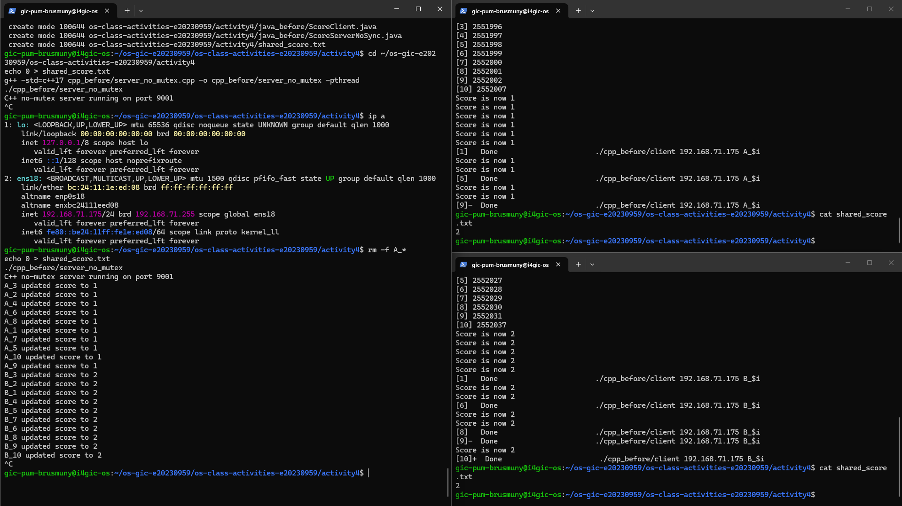
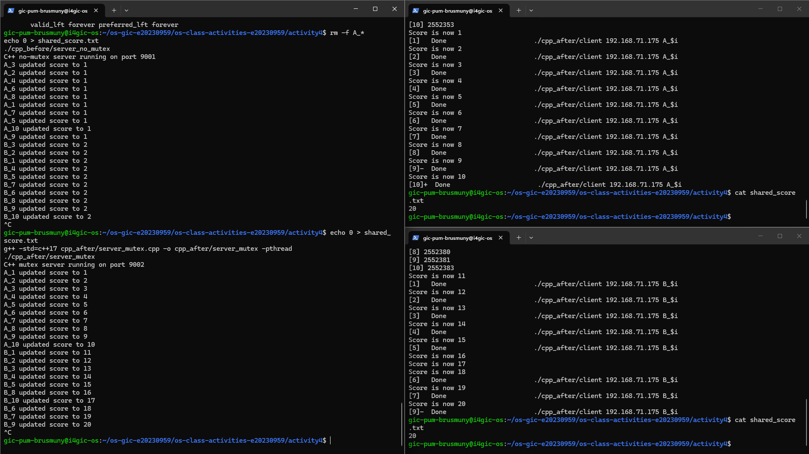
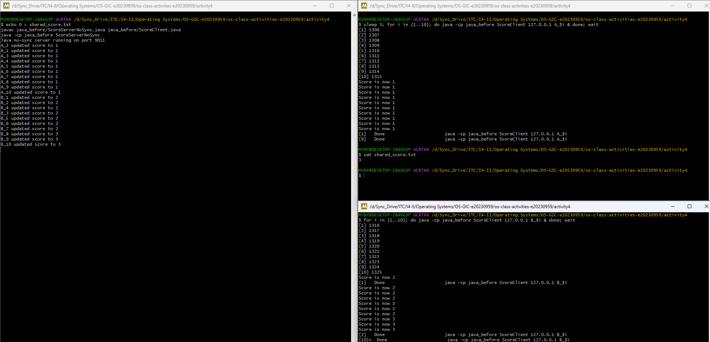
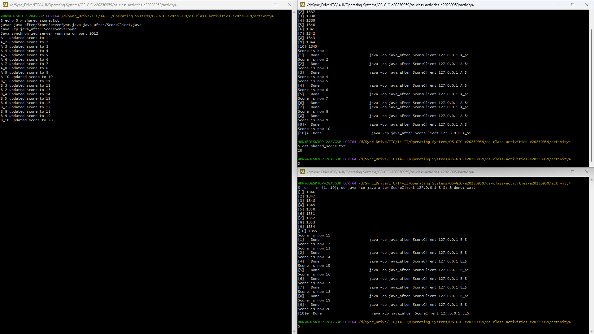

# Class Activity 4 — Shared File API

- **Student Name:** PUM BRUSMUNY
- **Student ID:** e20230959
- **Partner Name:** N/A (Completed solo with separate client terminals for Student A and Student B)
- **Partner Student ID:** N/A
- **Server Machine Owner:** PUM BRUSMUNY (`i4gic-os` for Tasks 1–2 C++, `DESKTOP-28AVG3P` for Tasks 3–4 Java)
- **Server IP Address:** `192.168.71.175` (C++ on `i4gic-os`) / `127.0.0.1` (Java local loopback on Windows)

---

## Task 1: C++ Before Mutex

- **Expected score after 20 total client requests:** 20
- **Actual score:** 2
- **What happened:** All 10 `A_*` requests arrived concurrently, read `0` from `shared_score.txt` at the same time before the 200 ms sleep, and all wrote `1`. Next, all 10 `B_*` requests arrived, read `1` concurrently, and all wrote `2`. Because `update_score()` had no mutex, 18 increments were lost due to race conditions and `cat shared_score.txt` ended at `2`.

---

## Task 2: C++ After Mutex

- **Expected score after 20 total client requests:** 20
- **Actual score:** 20
- **What changed after adding mutex:** Adding `std::lock_guard<std::mutex> lock(file_mutex);` at the start of `update_score()` forced every detached client thread to wait its turn to read, increment, and write `shared_score.txt`. Requests `A_1`–`A_10` incremented the score sequentially from `1` to `10`, and `B_1`–`B_10` continued cleanly from `11` to `20`, giving the exact expected final value `20`.

---

## Task 3: Java Before Synchronized

- **Expected score after 20 total client requests:** 20
- **Actual score:** 3
- **What happened:** Without `synchronized`, multiple Java client-handler threads entered `updateScore()` at the same time. All 10 `A_*` threads read `0` and wrote `1`, then `B_1`–`B_7` read `1` and wrote `2`, and `B_8`–`B_10` read `2` and wrote `3`. Seventeen updates were lost and `cat shared_score.txt` ended at `3`.

---

## Task 4: Java After Synchronized

- **Expected score after 20 total client requests:** 20
- **Actual score:** 20
- **What changed after adding synchronized:** Adding the `synchronized` modifier to `private static synchronized int updateScore(String name)` caused the JVM to serialize calls using `ScoreServerSync.class`'s monitor lock. Only one thread could read, sleep, increment, and write `shared_score.txt` at a time, so the score progressed cleanly from `1` to `20` across all 20 requests (`cat shared_score.txt` = `20`).

---

## Questions

1. **Why should clients send requests to the server instead of writing the file directly?**
   > Centralizing file access in a single server API guarantees only one program owns and touches `shared_score.txt`. Clients do not need direct filesystem access or distributed file-locking coordination across different machines; the server acts as a single control point that validates requests and enforces synchronization in one place.

2. **Why does the server still have a race condition before mutex or synchronized?**
   > Even though only the server touches `shared_score.txt`, the server spawns a separate thread for each incoming client connection (`std::thread(...).detach()` in C++ and `new Thread(...).start()` in Java). Without synchronization, multiple worker threads execute `update_score()` / `updateScore()` concurrently—reading the same old score before the 200 ms sleep and overwriting one another's writes (lost updates).

3. **In the C++ fixed version, what does `std::lock_guard<std::mutex>` protect?**
   > `std::lock_guard<std::mutex> lock(file_mutex);` protects the entire critical section inside `update_score()`—specifically reading the current score from `shared_score.txt`, sleeping 200 ms, incrementing `score`, and writing the new score back to `shared_score.txt`. It acquires `file_mutex` on construction and automatically releases it when `lock` goes out of scope (RAII), ensuring only one thread executes `update_score()` at a time.

4. **In the Java fixed version, what does `synchronized` protect?**
   > Marking `private static synchronized int updateScore(String name)` acquires the intrinsic monitor lock on the `ScoreServerSync.class` object for the duration of the method. It protects the critical section (reading `shared_score.txt`, sleeping 200 ms, incrementing `score`, and writing the updated value back) so only one thread at a time can execute `updateScore()`.

5. **Why is the final score expected to be 20 when Student A sends 10 requests and Student B sends 10 requests?**
   > `shared_score.txt` is reset to `0` before each test, and each client connection sends one request that triggers `score++` (an increment by `1`). With 10 requests from Student A and 10 requests from Student B (`10 + 10 = 20` total atomic updates starting from `0`), the expected final value is `20`.

6. **What could happen if two separate servers update the same file at the same time?**
   > An in-process `std::mutex` or Java `synchronized` monitor only coordinates threads **within the same process**. Two separate server processes have separate memory spaces and separate locks, so they could still read stale values and overwrite `shared_score.txt` simultaneously—causing race conditions, lost updates, or file corruption unless an OS-level inter-process lock (such as `flock()`/file locking) or an external database is used.

---

## Reflection

> This activity demonstrated a critical lesson in concurrent system design: **putting a single server API in front of a shared file eliminates multi-client direct file access, but does not eliminate race conditions if the server handles requests concurrently across threads.** Without synchronization, both the C++ (`2/20`) and Java (`3/20`) servers suffered severe lost updates during the 200 ms read-modify-write window.
>
> Comparing the two fixes highlighted how both languages achieve the same mutual exclusion with different idioms:
> - **C++ (`std::mutex` + `std::lock_guard`):** Uses an explicit mutex variable (`file_mutex`) paired with RAII (`lock_guard`), guaranteeing the lock is unlocked when the scope exits even if an early return or exception occurs.
> - **Java (`synchronized`):** Built directly into the language via intrinsic monitor locks on `ScoreServerSync.class` for static methods, making critical-section protection very concise while still guaranteeing only one thread updates `shared_score.txt` at a time.
>
> Overall, protecting a shared resource requires synchronizing the **entire** read-modify-write critical section inside the server—and if multiple server processes ever share the same storage, synchronization must move to OS file locks or an atomic database/transaction layer.
